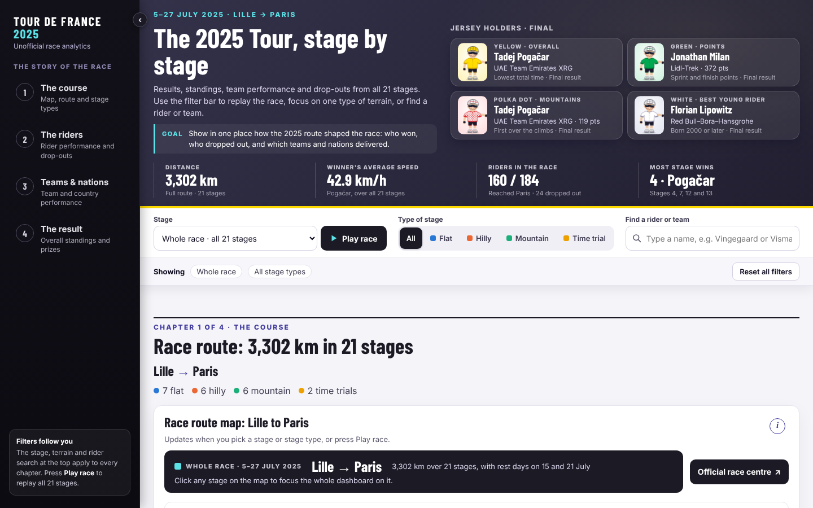
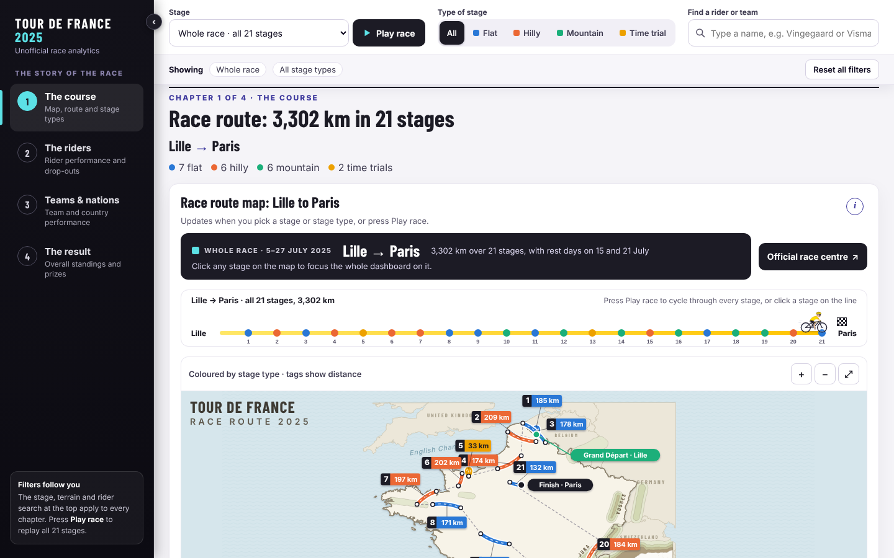
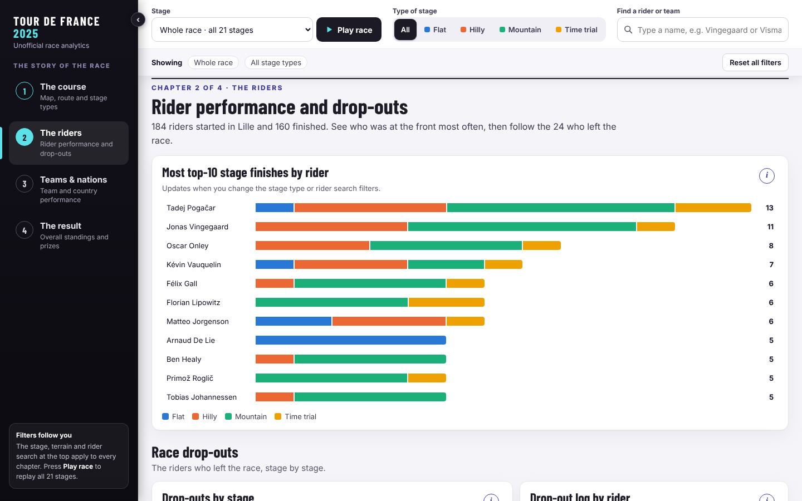
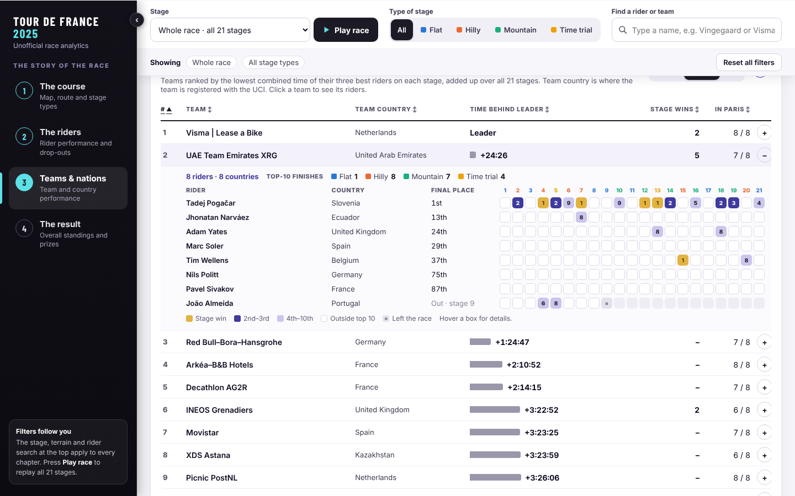
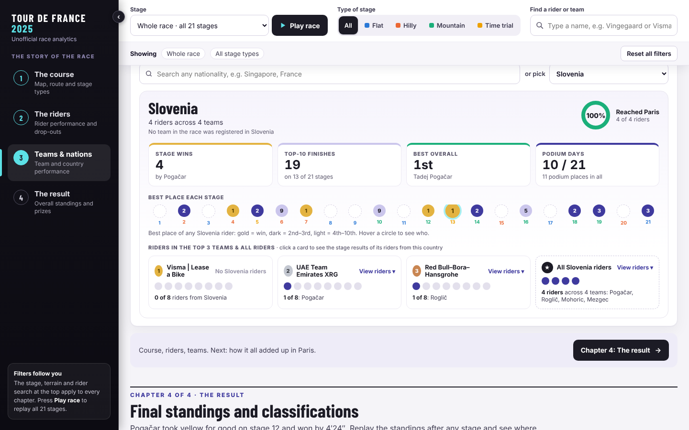
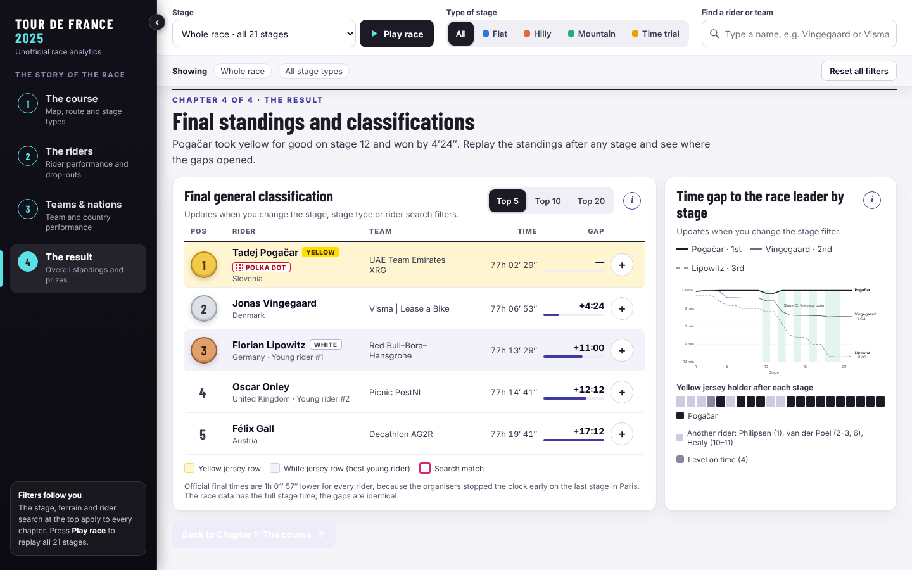
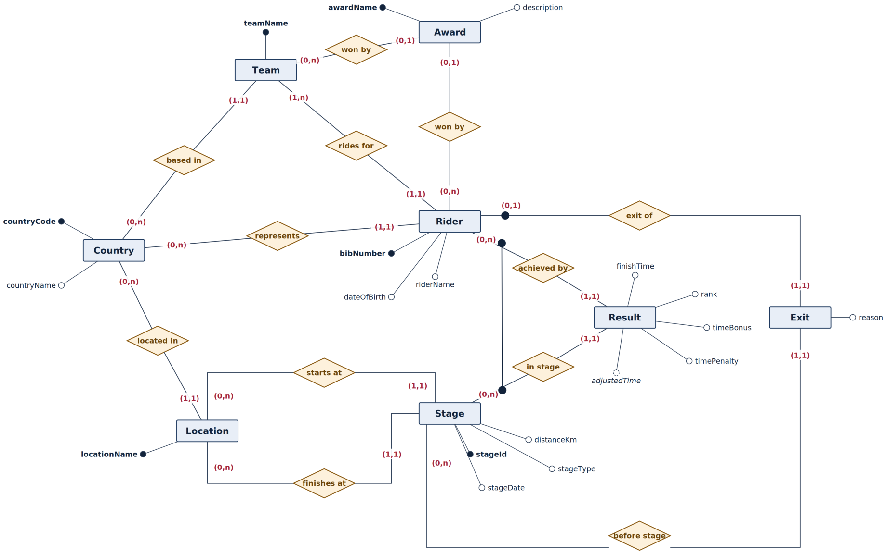

# Tour de France 2025 — Race Analytics

An end-to-end analytics project on the 2025 Tour de France: a **PostgreSQL database** normalised to BCNF, with business rules enforced by constraints, triggers and views, and an **interactive dashboard** that tells the story of the race stage by stage.

**[▶ Open the live dashboard](https://katie/nhi.github.io/tdf-2025-race-analytics/)**

> **Goal:** show in one place how the 2025 route shaped the race: who won, who dropped out, and which teams and nations delivered.



---

## At a glance

| | |
|---|---|
| **Data** | 21 stages · 3,302 km · 184 riders · 23 teams · 26 nationalities |
| **Database** | PostgreSQL 16 · 8 tables · 12 foreign keys · 5 trigger functions · 3 views · BCNF |
| **Testing** | 17 constraint tests, each trying to break one business rule, and all must be rejected |
| **Dashboard** | Single self-contained HTML page · 4 story chapters · global cross-filtering · drill-downs |

## The dashboard

The dashboard is a four-chapter story rather than a wall of charts. One filter bar (stage, terrain type, rider/team search) drives every chapter, and **Play race** replays all 21 stages.

| Chapter | Questions it answers |
|---|---|
| **1. The course** | Where did the race go? Which stages were long, flat or mountainous? Who won each stage? |
| **2. The riders** | Who finished in the top 10 most often, and on which terrain? Who dropped out, and where? |
| **3. Teams & nations** | Which team was strongest overall? Which riders carried their team? What did each nation achieve? |
| **4. The result** | Who won, by how much, and on which stage was the race decided? |

| Course | Riders |
|---|---|
|  |  |
| **Team drill-down** | **Nationality lens** |
|  |  |



**Key insight:** the race was decided on **stage 12 to Hautacam**, the first big mountain stage. The yellow jersey changed hands between Philipsen, van der Poel, Pogačar and Healy before that. From stage 12 Pogačar never lost it, and the time gaps open almost entirely on mountain stages.

## The data model



Eight tables: `country`, `team`, `rider`, `location`, `stage`, `result`, `exit`, `award`.

Key design decisions:

- **Rider nationality ≠ team country.** Riders have their own foreign key to `country`, independent of their team's. Pogačar is Slovenian but rides for an Emirati team.
- **Weak entities enforce rules structurally.** `result` is keyed on `(bib_number, stage_id)`, so there is one result per rider per stage. `exit` is keyed on `bib_number` alone, so a rider can withdraw at most once, with no trigger needed.
- **Derived values are views, not columns.** Adjusted time (`finish − bonus + penalty`), the general classification and the team classification are computed by views, so they can never drift from the raw results.
- **Cross-table rules use triggers, some of them deferred.** "A team must have at least one rider" conflicts with the foreign key during insertion, so it is a `DEFERRABLE INITIALLY DEFERRED` constraint trigger that is checked at commit.
- **Normalised to BCNF.** Decomposing a flat one-row-per-rider-per-stage table with the BCNF algorithm yields the same eight tables. The decomposition is lossless and dependency-preserving.

All 14 business rules and how each one is enforced: [docs/business_rules.md](docs/business_rules.md).

## SQL highlights

| File | What's in it |
|---|---|
| [`sql/01_schema.sql`](sql/01_schema.sql) | Tables, constraints, triggers and views |
| [`sql/02_constraint_tests.sql`](sql/02_constraint_tests.sql) | Valid sample load, plus 17 statements that must each be rejected |
| [`sql/03_dashboard_queries.sql`](sql/03_dashboard_queries.sql) | 11 analytical queries behind the dashboard |
| [`sql/04_star_schema.sql`](sql/04_star_schema.sql) | Star schema (`fact_result` + 4 dimensions) loaded from the normalised tables |

Techniques used: window functions (`RANK`, `ROW_NUMBER`, running totals with `SUM() OVER`), CTEs, conditional aggregation with `FILTER`, anti-joins with `NOT EXISTS`, deferred constraint triggers, and views for derived data.

Example: **standings after every stage**, with the gap to the leader:

```sql
WITH cum AS (
    SELECT bib_number, stage_id,
           SUM(adjusted_time_sec) OVER (PARTITION BY bib_number ORDER BY stage_id) AS cum_time,
           COUNT(*)               OVER (PARTITION BY bib_number ORDER BY stage_id) AS stages_done
    FROM   v_result
)
SELECT stage_id, bib_number,
       RANK() OVER (PARTITION BY stage_id ORDER BY cum_time) AS gc_pos,
       cum_time - MIN(cum_time) OVER (PARTITION BY stage_id) AS gap_sec
FROM   cum
WHERE  stages_done = stage_id          -- only riders who completed every stage so far
ORDER  BY stage_id, gc_pos;
```

## Run it yourself

**Dashboard:** open `index.html` in any browser. It's fully self-contained, with no server or install needed.

**Database** (PostgreSQL 14+):

```bash
createdb tdf
psql -d tdf -f sql/01_schema.sql
psql -d tdf -f sql/02_constraint_tests.sql      # loads sample data, then 17 expected errors
psql -d tdf -f sql/03_dashboard_queries.sql
psql -d tdf -f sql/04_star_schema.sql
```

## Project structure

```
├── index.html                 # the dashboard (self-contained)
├── sql/
│   ├── 01_schema.sql
│   ├── 02_constraint_tests.sql
│   ├── 03_dashboard_queries.sql
│   └── 04_star_schema.sql
└── docs/
    ├── er_diagram.png
    ├── business_rules.md
    └── screenshots/
```

## Data notes and limitations

- **Points (green) and mountains (polka dot) classifications** come from the official 2025 results. The database records award winners, not points per stage. A `classification_points` table would allow computing them.
- **Total times** in the data are 1h 01′ 57″ higher than the official results for every rider, because the organisers stopped the clock early on the final stage in Paris. Gaps between riders are identical.
- **Team country** (UCI registration) and map coordinates are not part of the race data and were added for context. Map lines join start and finish towns rather than following actual roads.
- **No elevation data**, so the stage profile chart shows distance, not altitude.

## About

Built by **Nhi Tran**. The project started as an individual assignment in a graduate data management course and was extended independently.

*Personal project, not affiliated with the Tour de France or A.S.O.*
